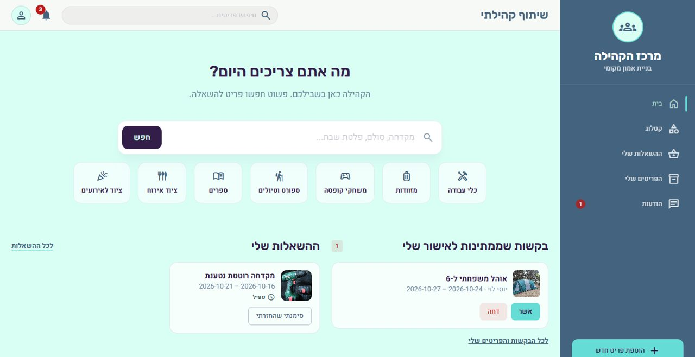
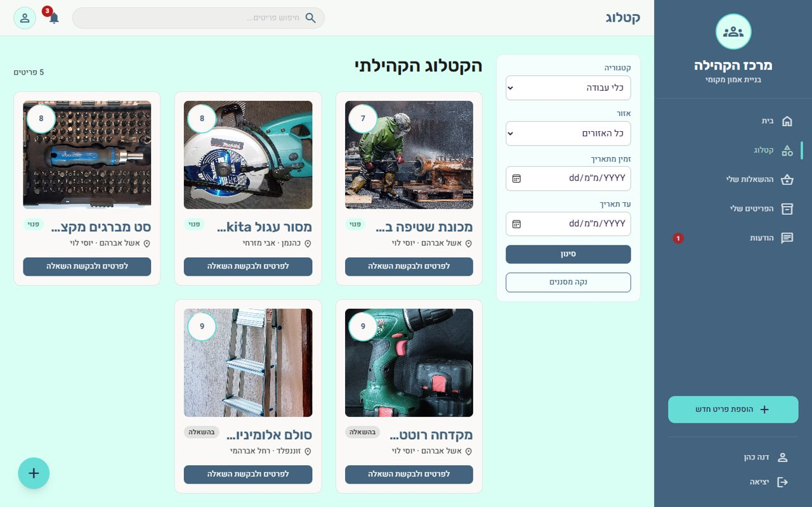
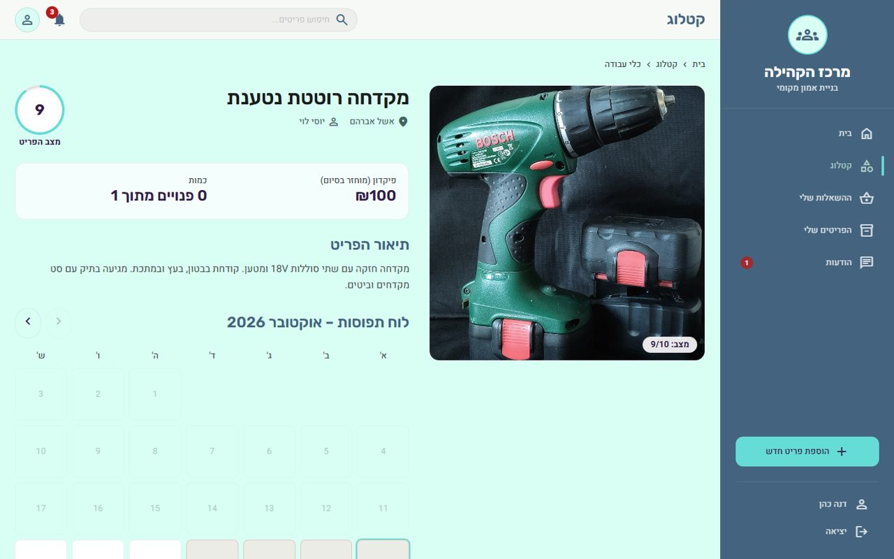
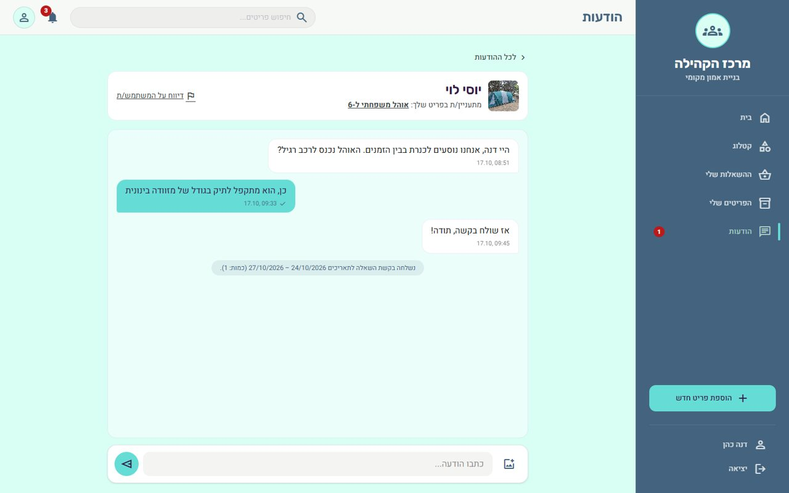
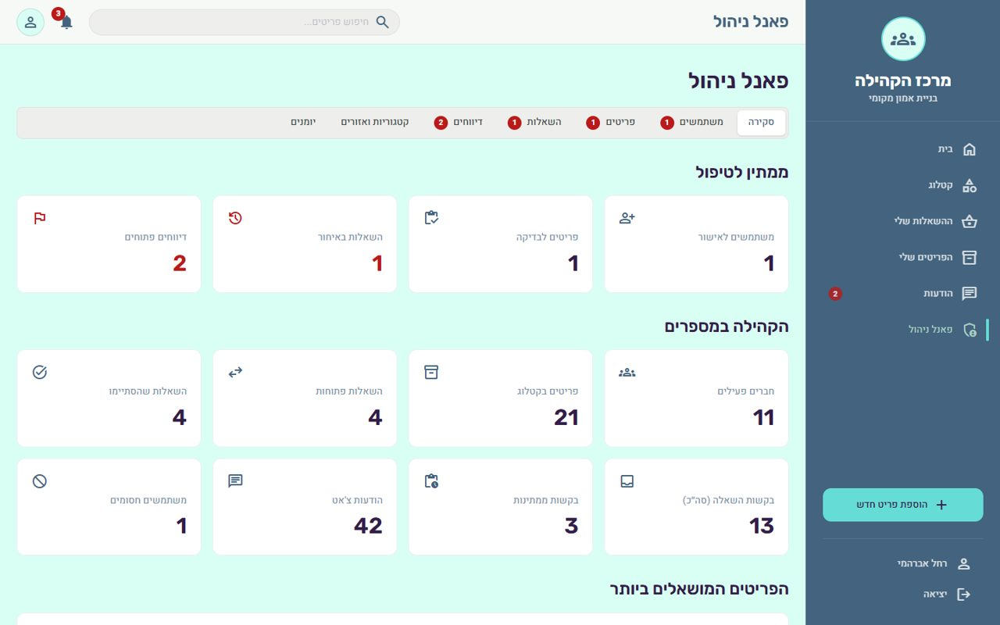
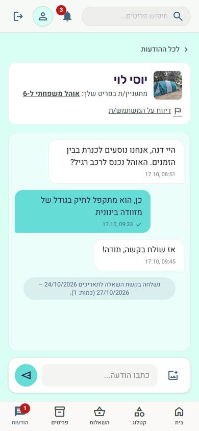

# שיתוף קהילתי

**פלטפורמה סגורה להשאלת ציוד בין שכנים: קטלוג משותף, בקשות לתאריכים, צ'אט לתיאום, התראות בזמן אמת
ופאנל ניהול לאדמין הקהילה.**

🔗 **האתר החי:** https://community-share-bice.vercel.app



## הבעיה

בכל קהילה יש ציוד יקר שנמצא בשימוש פעמיים בשנה: מקדחה, סולם, מזוודה גדולה, מיחם לאירוע. רוב האנשים
קונים אותו בעצמם, כי אין דרך פשוטה לדעת למי מהשכנים יש מה, מתי הוא פנוי, ואיך לבקש בלי אי-נעימות. ומי
שכן משאיל, מתקשה לעקוב אחרי מה שיצא ומתי הוא אמור לחזור.

## הפתרון

| | |
|---|---|
|  |  |
| **קטלוג וחיפוש** – סינון לפי קטגוריה, אזור וזמינות בתאריכים, עם השלמה אוטומטית | **עמוד פריט** – תמונות, מצב 1–10, פיקדון, ולוח תפוסות שמראה מתי הפריט פנוי |
|  |  |
| **צ'אט לכל פריט** – תיאום איסוף והחזרה, שיתוף תמונות, הודעות אוטומטיות על כל שלב בהשאלה | **פאנל ניהול** – אישור חברים ופריטים, טיפול בדיווחים ובאיחורים, סטטיסטיקות ויומן פעולות |

<p align="center"></p>

## מה המערכת עושה

**חבר קהילה**
- נרשם ומאמת את המייל; אדמין הקהילה מאשר אותו לפני הכניסה
- מחפש ציוד, שולח בקשת השאלה לתאריכים וכמות, ועוקב אחרי ההשאלות שלו
- שואל את בעל הפריט בצ'אט לפני שהוא מבקש, ומתאם איתו את האיסוף
- מסמן שהחזיר, ומדווח על בעיה בפריט או על משתמש

**בעל פריט**
- מעלה פריטים עם תמונות, מצב, כמות ופיקדון; כל פריט עובר אישור אדמין
- מאשר או דוחה בקשות, מסמן קבלת פיקדון ומאשר החזרה

**מנהל קהילה**
- מאשר חברים ופריטים, חוסם ומשחרר, מסיר פריט מהקטלוג
- מטפל בדיווחים, וסוגר השאלה שבעל הפריט לא עדכן
- מנהל את רשימת הקטגוריות והאזורים
- רואה סטטיסטיקות, יומן פעולות אדמין ויומן מיילים

**אוטומטי**
- התראות בתוך האתר ובזמן אמת: בקשה חדשה, אישור, דחייה, הודעה חדשה, תזכורת ואיחור
- מיילים דרך Resend, ומשימה יומית שמסמנת איחורים ושולחת תזכורת יום לפני מועד ההחזרה

## טכנולוגיות

| שכבה | טכנולוגיה |
|---|---|
| ממשק | Next.js 16 (App Router), React 19, TypeScript, Tailwind CSS 4, עברית ו-RTL |
| שרת | Server Actions, ולידציה עם Zod |
| מסד נתונים | Supabase – PostgreSQL עם Row Level Security, פונקציות ו-triggers |
| אימות | Supabase Auth – אימייל וסיסמה, אימות כתובת |
| קבצים | Supabase Storage – buckets פרטיים עם קישורים חתומים |
| זמן אמת | Supabase Realtime |
| מיילים | Resend |
| פריסה ותזמון | Vercel, Vercel Cron |

## ארכיטקטורה

```
דפדפן
  │  כל קריאה וכתיבה עוברת דרך השרת. החיבור הישיר היחיד הוא האזנה ל-Realtime,
  │  שמשמשת כאות "משהו השתנה" ומציגה הודעות צ'אט מיד.
  ▼
proxy.ts ─────── רענון סשן, הפניה לפי סטטוס ותפקיד, Content-Security-Policy עם nonce
  ▼
Server Components ── קריאת נתונים דרך ה-Repository
Server Actions ───── משתמש מחובר ← ולידציה (Zod) ← הגבלת קצב ← Repository ← מייל
  ▼
Repository (lib/data) ── ממשק אחד, שני מימושים: Supabase, ומצב דמו בזיכרון
  ▼
Supabase ── טבלאות לקריאה בלבד תחת RLS; כל כתיבה היא פונקציית מסד שבודקת מי הקורא,
            ו-triggers כותבים את ההתראות ואת הודעות המערכת באותה טרנזקציה
```

**החלטות שכדאי להכיר:**
- **ההרשאות נאכפות במסד, לא רק בממשק.** ללקוחות אין הרשאת כתיבה לאף טבלה; כל שינוי עובר דרך פונקציה
  שמזהה את הקורא ובודקת בעלות, סטטוס וחוקים עסקיים.
- **אין אישור כפול על אותה יחידה.** אישור בקשה נועל את שורת הפריט ובודק זמינות מחדש בתוך טרנזקציה אחת.
- **שיחות פרטיות.** רק שני הצדדים רואים שיחה, גם לא אדמין; בעיה מגיעה אליו דרך דיווח.
- **התראות שאי אפשר לזייף.** הן נכתבות ב-triggers ברגע האירוע, וללקוח אין גישת כתיבה אליהן.

## תיעוד

| מסמך | תוכן |
|---|---|
| [אפיון](docs/SPEC.md) | הבעיה, קהל היעד, המסכים, החיבורים, מבנה הנתונים וההרשאות |
| [מודל הנתונים](docs/DATA_MODEL.md) · [ERD](docs/ERD.md) | כל הטבלאות, השדות, האילוצים והפונקציות |
| [הרשאות (RLS)](docs/RLS.md) · [אבטחה](SECURITY.md) | מי רואה ומי רשאי לשנות מה, ואיך זה נאכף |
| [חיבורים חיצוניים](docs/INTEGRATIONS.md) | Resend, המשימה היומית ו-Realtime |
| [תרשימי זרימה](docs/FLOWS.md) | המסלול המרכזי, מצבי ההשאלה, צ'אט ודיווחים |
| [תוכנית בדיקות](docs/TEST_PLAN.md) | בדיקות ידניות מקצה לקצה, כולל ניסיונות גישה לא מורשים |

## הרצה מקומית

דרוש Node.js 20 ומעלה.

```bash
npm install
cp .env.example .env.local
npm run dev
```

עם `USE_MOCK_DATA=true` (ברירת המחדל) האתר רץ על נתוני דמו בזיכרון, בלי מסד נתונים: נכנסים ל-`/login`
ובוחרים משתמש דמו.

### מול Supabase

1. ליצור פרויקט Supabase ולהריץ את הקבצים שב-`supabase/migrations/` לפי הסדר (001 עד 007).
2. למלא את משתני הסביבה (בטבלה למטה) ולהגדיר `USE_MOCK_DATA=false`.
3. ב-Supabase ← Authentication ← URL Configuration: להגדיר Site URL, ולהוסיף את
   `{SITE_URL}/auth/callback` ל-Redirect URLs.
4. להירשם באתר, ולהפוך את החשבון הראשון לאדמין (פעם אחת):
   ```sql
   UPDATE public.users SET role = 'admin', status = 'approved' WHERE email = 'you@example.com';
   ```

### נתוני דמו

הסקריפט יוצר קהילה מלאה: 10 חברים, 21 פריטים עם תמונות, השאלות בכל המצבים, שיחות, התראות ודיווחים.
כל הכתובות ב-`@example.com`, כך שאף אדם אמיתי לא מקבל מהן מייל.

```bash
node --env-file=.env.local --experimental-strip-types scripts/seed-demo.ts           # יצירה
node --env-file=.env.local --experimental-strip-types scripts/seed-demo.ts --remove  # מחיקה
```

התמונות מ-Wikimedia Commons; הקרדיטים ב-[`scripts/demo-data/images/CREDITS.md`](scripts/demo-data/images/CREDITS.md).

### משתני סביבה

| משתנה | סודי? | תיאור |
|---|---|---|
| `USE_MOCK_DATA` | לא | `true` למצב דמו בלי מסד נתונים |
| `NEXT_PUBLIC_SITE_URL` | לא | כתובת האתר, לקישורים במיילים |
| `NEXT_PUBLIC_SUPABASE_URL` | לא | כתובת פרויקט Supabase |
| `NEXT_PUBLIC_SUPABASE_ANON_KEY` | לא | מפתח ציבורי; ההגנה היא ב-RLS |
| `SUPABASE_SERVICE_ROLE_KEY` | **כן** | צד שרת בלבד: הגבלת קצב, מיילים, משימה יומית |
| `RESEND_API_KEY` | **כן** | צד שרת בלבד. בלעדיו המיילים מדולגים ונרשמים ביומן |
| `EMAIL_FROM` | לא | כתובת השולח, מדומיין מאומת ב-Resend |
| `CRON_SECRET` | **כן** | מגן על `/api/cron/daily` |
| `DEMO_USER_PASSWORD`, `DEMO_ADMIN_PASSWORD` | **כן** | רק לסקריפט נתוני הדמו |

שום סוד לא נמצא בקוד או ב-git; קובצי `.env*` מוחרגים ב-`.gitignore`.

### בדיקות

```bash
npm run lint
npx tsc --noEmit
npm run build
```
