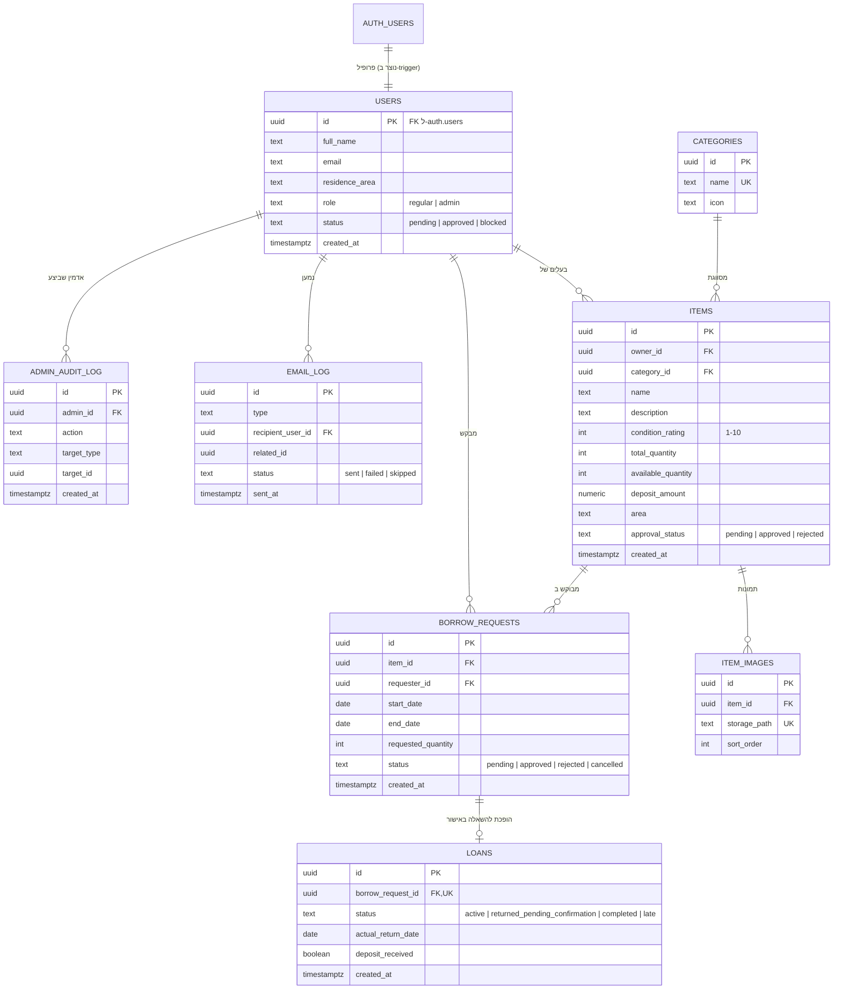

# תרשים ישויות וקשרים (ERD)

טבלה נוספת, `rate_limits` (מפתח מגובב, תחילת חלון, מונה), משמשת את הגבלת הקצב ואינה קשורה לטבלאות האחרות.

פירוט השדות, הסוגים והאילוצים: [`DATA_MODEL.md`](DATA_MODEL.md).
