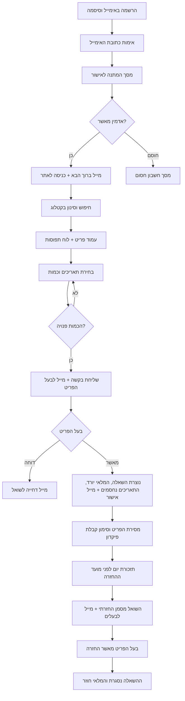
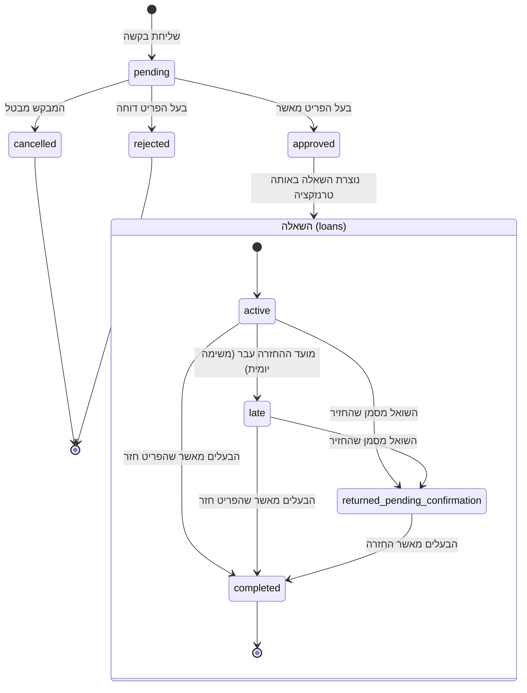
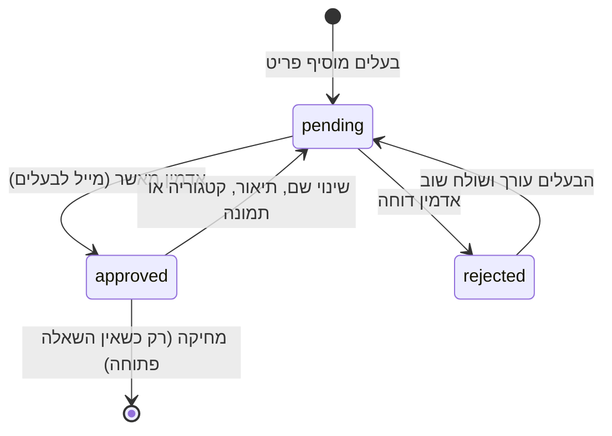
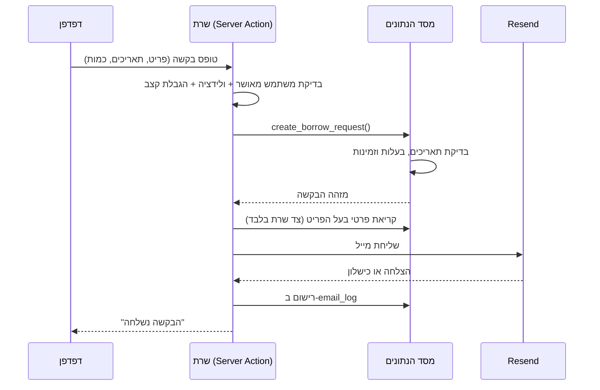

# תרשימי זרימה

## המסלול המרכזי

## מכונת המצבים של בקשה והשאלה

בעל הפריט יכול לסגור השאלה גם אם השואל לא סימן "החזרתי" – הוא זה שיודע אם הפריט אכן חזר.

## מחזור החיים של פריט

## מה קורה בפעולה אחת (דוגמה: שליחת בקשה)

