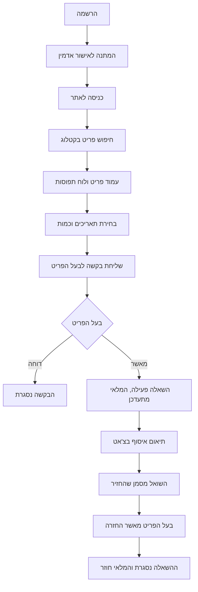
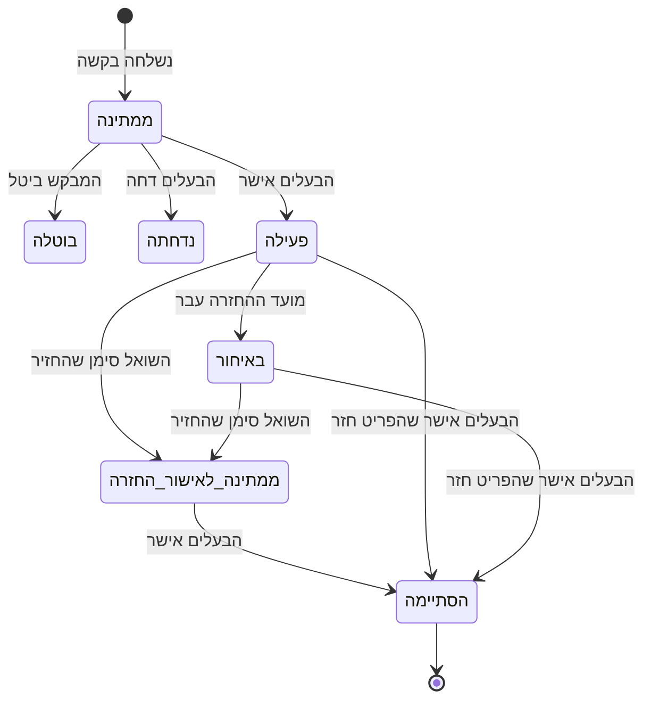

# אפיון המערכת – שיתוף קהילתי

הבעיה, קהל היעד, המסכים, החיבורים החיצוניים, מבנה הנתונים וההרשאות. התרשימים כתובים ב-Mermaid,
ו-GitHub מציג אותם כתרשימים.

---

## משפט הבעיה

בכל קהילה יש ציוד יקר שנמצא בשימוש רק פעמים ספורות בשנה – מקדחה, סולם, מזוודה גדולה, מיחם לאירוע.
רוב האנשים קונים אותו בעצמם, כי אין דרך פשוטה לדעת למי מהשכנים יש מה, מתי הוא פנוי, ואיך לבקש אותו בלי
אי-נעימות. ומי שכן משאיל, מתקשה לעקוב אחרי מה שיצא ומתי הוא אמור לחזור.

**שיתוף קהילתי** היא פלטפורמה סגורה לקהילה אחת, שהופכת את ההשאלה לתהליך מסודר: קטלוג משותף, בקשה
לתאריכים מסוימים, אישור של בעל הפריט, תיאום בצ'אט פנימי ומעקב אחרי ההחזרה – עם התראות בזמן אמת,
תזכורות אוטומטיות במייל, ותחת פיקוח של אדמין הקהילה.

---

## קהל יעד

קהילות סגורות שחבריהן מכירים זה את זה: בניין מגורים, רחוב או שכונה, משפחה מורחבת, קבוצת חברים, קהילת
לימודים או עבודה.

| סוג משתמש | מה הוא עושה במערכת |
|---|---|
| חבר קהילה | מחפש ציוד, שולח בקשות השאלה, מתאם בצ'אט, מסמן החזרה, מדווח על בעיות |
| בעל פריט | מעלה פריטים, מאשר או דוחה בקשות, מאשר החזרה ומסמן קבלת פיקדון |
| מנהל קהילה | מאשר חברים ופריטים, חוסם, מטפל בדיווחים, סוגר השאלות תקועות, מנהל קטגוריות ואזורים |

---

## רשימת המסכים

| מסך | כתובת | מה עושים בו |
|---|---|---|
| התחברות, הרשמה, שחזור סיסמה | `/login`, `/register`, `/forgot-password` | כניסה למערכת |
| המתנה לאישור / חסום | `/pending-approval`, `/blocked` | מה שרואה מי שעוד לא אושר או נחסם |
| בית | `/` | חיפוש, קטגוריות, בקשות שמחכות לי, ההשאלות שלי |
| קטלוג | `/catalog` | חיפוש וסינון לפי קטגוריה, אזור וזמינות בתאריכים |
| פריט | `/items/[id]` | פרטים, תמונות, לוח תפוסות, בקשת השאלה, שאלה לבעלים, דיווח |
| בקשת השאלה | `/items/[id]/borrow` | בחירת תאריכים וכמות |
| הוספה / עריכה של פריט | `/items/new`, `/items/[id]/edit` | תמונות, מצב, כמות, פיקדון |
| ההשאלות שלי | `/my-loans` | מעקב, סימון החזרה, צ'אט עם הבעלים |
| הפריטים שלי | `/my-items` | אישור ודחיית בקשות, אישור החזרה, פיקדון, צ'אט עם השואל |
| הודעות | `/messages`, `/messages/[id]` | רשימת השיחות והשיחה עצמה, כולל תמונות |
| התראות | `/notifications` | כל מה שקרה מאז הביקור האחרון |
| דיווח על בעיה | `/report` | דיווח על פריט או משתמש, ומעקב אחרי הטיפול |
| פרופיל | `/profile` | שם, אזור, סיסמה |
| פאנל ניהול | `/admin` | שבע לשוניות: סקירה, משתמשים, פריטים, השאלות, דיווחים, קטגוריות ואזורים, יומנים |

---

## חיבורים חיצוניים

### Resend – שליחת מיילים

המערכת שולחת מיילים אוטומטיים דרך שירות Resend, כדי שהמשתמשים לא יצטרכו להיכנס לאתר ולבדוק אם משהו
השתנה.

| אירוע | נמען |
|---|---|
| נשלחה בקשת השאלה | בעל הפריט |
| בקשה אושרה או נדחתה | השואל |
| משתמש אושר על ידי אדמין | המשתמש |
| פריט אושר על ידי אדמין | בעל הפריט |
| תזכורת יום לפני מועד ההחזרה | השואל |
| השאלה עברה לאיחור | השואל ובעל הפריט |
| השואל סימן שהחזיר | בעל הפריט |

המיילים בעברית, מימין לשמאל, עם כפתור שמוביל לעמוד הרלוונטי באתר.

**אבטחה:** מפתח ה-API של Resend שמור כמשתנה סביבה בשרת בלבד. הוא אינו מופיע בקוד, אינו נשלח לדפדפן,
והשליחה מתבצעת רק מצד השרת. כישלון בשליחה אינו מכשיל את הפעולה שהפעילה אותה, אלא נרשם ביומן.

**יומן מיילים:** כל ניסיון שליחה נרשם בטבלת `email_log`. היומן מונע שליחה כפולה של תזכורות, ומוצג
לאדמין בפאנל הניהול.

### משימה יומית מתוזמנת (Vercel Cron)

פעם ביום רצה משימה שמסמנת השאלות שמועדן עבר כ"באיחור", ושולחת תזכורות והודעות איחור. הנתיב מוגן בסוד
(`CRON_SECRET`) ואינו ניתן להפעלה בלעדיו.

### Supabase Realtime – עדכונים בזמן אמת

הודעת צ'אט חדשה, התראה חדשה ושינוי בסטטוס של בקשה או השאלה מופיעים אצל הצד השני מיד, בלי לרענן את
הדף. זה מה שמאפשר לתאם איסוף בתוך המערכת במקום לעבור לוואטסאפ.

**אבטחה:** הדפדפן רק מאזין לשינויים; כל כתיבה עוברת דרך השרת. כל משתמש מקבל עדכון רק על מידע שהוא
רשאי לראות, ולכן הודעה בצ'אט מגיעה רק לשני המשתתפים בו.

### Supabase

מסד נתונים PostgreSQL, אימות משתמשים (Auth) ואחסון תמונות (Storage).

---

## מבנה הנתונים

| טבלה | תפקיד | שדות עיקריים |
|---|---|---|
| `users` | חברי הקהילה | שם מלא, אימייל, אזור מגורים, תפקיד (`regular` / `admin`), סטטוס (`pending` / `approved` / `blocked`) |
| `categories` | קטגוריות (האדמין מנהל) | שם, אייקון |
| `areas` | אזורים (האדמין מנהל) | שם, סדר הצגה |
| `items` | פריטים להשאלה | בעלים, קטגוריה, שם, תיאור, מצב (1–10), כמות כוללת, כמות פנויה, פיקדון, אזור, סטטוס אישור (`pending` / `approved` / `rejected`) |
| `item_images` | תמונות הפריטים | פריט, נתיב הקובץ, סדר הצגה |
| `borrow_requests` | בקשות השאלה | פריט, מבקש, תאריך התחלה וסיום, כמות, סטטוס (`pending` / `approved` / `rejected` / `cancelled`) |
| `loans` | השאלות | הבקשה שממנה נוצרה, סטטוס (`active` / `returned_pending_confirmation` / `completed` / `late`), תאריך החזרה בפועל, האם התקבל פיקדון |
| `conversations` | שיחות | הפריט, בעל הפריט, החבר המתעניין, עד איפה כל צד קרא |
| `messages` | הודעות | שיחה, שולח, סוג (`text` / `image` / `system`), תוכן, תמונה |
| `notifications` | התראות באתר | למי, סוג, כותרת, תוכן, קישור, האם נקראה |
| `reports` | דיווחים | מי דיווח, על מה (פריט / משתמש), סיבה, פירוט, סטטוס טיפול, הערת אדמין |
| `email_log` | יומן מיילים | סוג ההודעה, נמען, הישות הקשורה, סטטוס, זמן |
| `admin_audit_log` | יומן פעולות אדמין | מי ביצע, איזו פעולה, על מי |

**קשרים:** משתמש הוא בעלים של פריטים רבים; לפריט יש תמונות רבות ובקשות רבות; בקשה מאושרת יוצרת השאלה
אחת בדיוק. לכל צמד של פריט וחבר מתעניין יש שיחה אחת, ובה הודעות רבות; כך כל התיאום על פריט מסוים
מרוכז במקום אחד, יחד עם ההודעות האוטומטיות על מה שקרה בהשאלה. כל הקשרים מוגדרים כמפתחות זרים, וערכי הסטטוס והטווחים המספריים נאכפים באילוצי `CHECK`.

**חישוב זמינות:** הזמינות מחושבת לכל יום בנפרד – כמה יחידות תפוסות בהשאלות שלא הסתיימו – ולא נשמרת
כשדה. אישור בקשה מתבצע כטרנזקציה אחת שנועלת את הפריט, בודקת את הזמינות מחדש, מעדכנת את המלאי ויוצרת את
ההשאלה, כך שלא ייתכן אישור כפול על אותה יחידה.

---

## הרשאות

הגישה לנתונים נאכפת במסד הנתונים עצמו (Row Level Security), ולא רק בממשק.

| סוג משתמש | מה הוא רואה | מה הוא יכול לעשות |
|---|---|---|
| אורח | כלום – מופנה למסך ההתחברות | להירשם ולהתחבר |
| ממתין לאישור / חסום | רק את מסך ההמתנה או החסימה | – |
| חבר קהילה | פריטים מאושרים; הבקשות, ההשאלות, השיחות, ההתראות והדיווחים שלו | לבקש השאלה, לבטל בקשה ממתינה, לסמן "החזרתי", לשאול את בעל הפריט בצ'אט, לדווח על בעיה, לעדכן את הפרופיל |
| בעל פריט | גם את הפריטים שלו בכל סטטוס, ואת הבקשות עליהם | להוסיף, לערוך ולמחוק פריטים; לאשר ולדחות בקשות; לאשר החזרה; לסמן קבלת פיקדון; לשוחח עם מי שביקש את הפריט |
| אדמין | הכול, **חוץ משיחות פרטיות** | לאשר משתמשים ופריטים; לחסום ולשחרר משתמשים; להסיר פריט מהקטלוג; לסגור השאלה תקועה; לטפל בדיווחים; לנהל קטגוריות ואזורים |

**עקרונות:**

- לקוחות יכולים רק לקרוא מהטבלאות. כל שינוי עובר דרך פונקציה במסד שבודקת מי מבצע אותו.
- משתמש אינו יכול לשנות לעצמו תפקיד או סטטוס – אין פעולה כזו במערכת.
- כתובות אימייל של חברים אחרים אינן גלויות. שני הצדדים של השאלה מקבלים זה את כתובתו של זה, ורק הם.
- חסימת משתמש נכנסת לתוקף מיד, גם אם הוא מחובר באותו רגע.
- תמונות הפריטים שמורות באחסון פרטי ונגישות רק לחברים מאושרים, דרך קישור זמני.
- שיחה בצ'אט גלויה רק לשני המשתתפים בה. גם אדמין אינו קורא שיחות; בעיה מגיעה אליו דרך דיווח.
- דיווח גלוי רק למי ששלח אותו ולאדמין. מי שדווח עליו אינו יודע מי דיווח.
- התראות והודעות מערכת נכתבות על ידי המסד עצמו ברגע האירוע, כך שאי אפשר לזייף אותן.
- כל פעולת אדמין (אישור, חסימה, הסרת פריט, סגירת השאלה, טיפול בדיווח) נרשמת ביומן.

---

## תרשימי זרימה

### המסלול המרכזי

### מצבי ההשאלה

