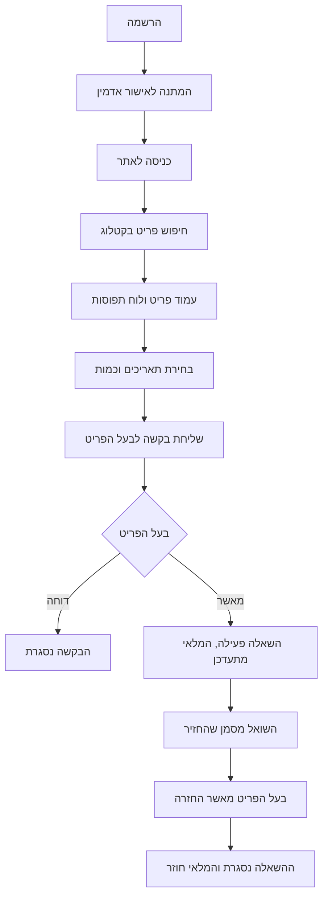
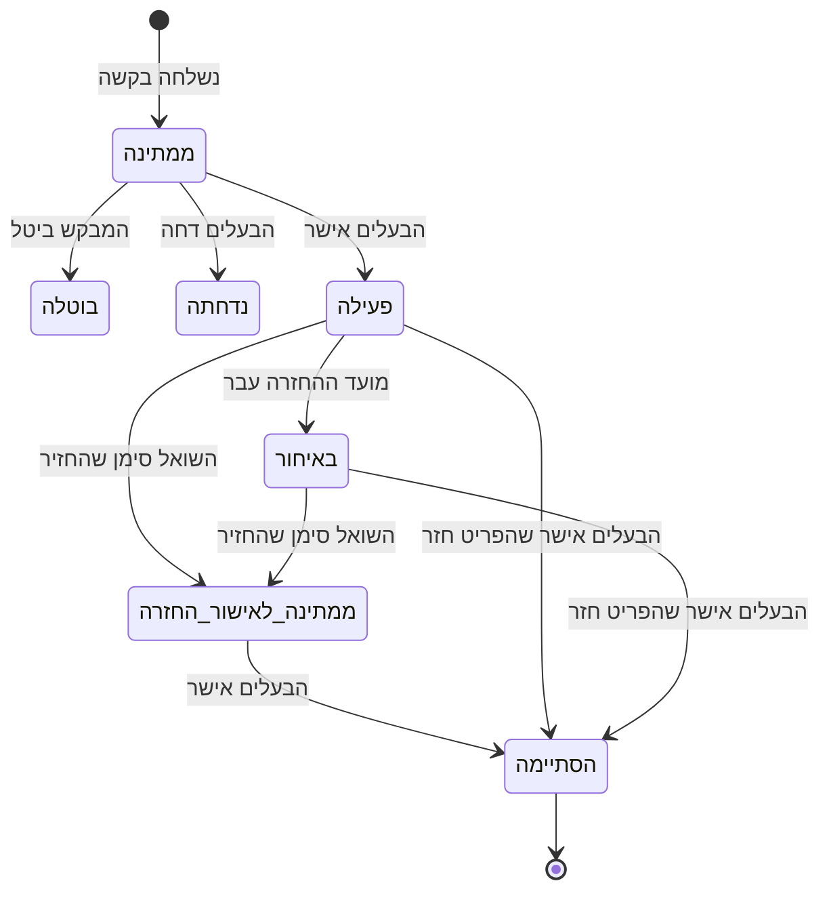

# תוספות למסמך האפיון

סעיפים מנוסחים, מוכנים להדבקה במסמך האפיון. התרשימים כתובים ב-Mermaid: אפשר להדביק את הקוד שלהם
ב-https://mermaid.live ולייצא כתמונה.

---

## משפט הבעיה

בכל קהילה יש ציוד יקר שנמצא בשימוש רק פעמים ספורות בשנה – מקדחה, סולם, מזוודה גדולה, מיחם לאירוע.
רוב האנשים קונים אותו בעצמם, כי אין דרך פשוטה לדעת למי מהשכנים יש מה, מתי הוא פנוי, ואיך לבקש אותו בלי
אי-נעימות. ומי שכן משאיל, מתקשה לעקוב אחרי מה שיצא ומתי הוא אמור לחזור.

**שיתוף קהילתי** היא פלטפורמה סגורה לקהילה אחת, שהופכת את ההשאלה לתהליך מסודר: קטלוג משותף, בקשה
לתאריכים מסוימים, אישור של בעל הפריט, ומעקב אחרי ההחזרה – עם תזכורות אוטומטיות במייל ותחת פיקוח של
אדמין הקהילה.

---

## חיבורים חיצוניים

### Resend – שליחת מיילים

המערכת שולחת מיילים אוטומטיים דרך שירות Resend, כדי שהמשתמשים לא יצטרכו להיכנס לאתר ולבדוק אם משהו
השתנה.

| אירוע | נמען |
|---|---|
| נשלחה בקשת השאלה | בעל הפריט |
| בקשה אושרה או נדחתה | השואל |
| משתמש אושר על ידי אדמין | המשתמש |
| פריט אושר על ידי אדמין | בעל הפריט |
| תזכורת יום לפני מועד ההחזרה | השואל |
| השאלה עברה לאיחור | השואל ובעל הפריט |
| השואל סימן שהחזיר | בעל הפריט |

המיילים בעברית, מימין לשמאל, עם כפתור שמוביל לעמוד הרלוונטי באתר.

**אבטחה:** מפתח ה-API של Resend שמור כמשתנה סביבה בשרת בלבד. הוא אינו מופיע בקוד, אינו נשלח לדפדפן,
והשליחה מתבצעת רק מצד השרת. כישלון בשליחה אינו מכשיל את הפעולה שהפעילה אותה, אלא נרשם ביומן.

**יומן מיילים:** כל ניסיון שליחה נרשם בטבלת `email_log`. היומן מונע שליחה כפולה של תזכורות, ומוצג
לאדמין בפאנל הניהול.

### משימה יומית מתוזמנת (Vercel Cron)

פעם ביום רצה משימה שמסמנת השאלות שמועדן עבר כ"באיחור", ושולחת תזכורות והודעות איחור. הנתיב מוגן בסוד
(`CRON_SECRET`) ואינו ניתן להפעלה בלעדיו.

### Supabase

מסד נתונים PostgreSQL, אימות משתמשים (Auth) ואחסון תמונות (Storage).

---

## מבנה הנתונים

| טבלה | תפקיד | שדות עיקריים |
|---|---|---|
| `users` | חברי הקהילה | שם מלא, אימייל, אזור מגורים, תפקיד (`regular` / `admin`), סטטוס (`pending` / `approved` / `blocked`) |
| `categories` | קטגוריות | שם, אייקון |
| `items` | פריטים להשאלה | בעלים, קטגוריה, שם, תיאור, מצב (1–10), כמות כוללת, כמות פנויה, פיקדון, אזור, סטטוס אישור (`pending` / `approved` / `rejected`) |
| `item_images` | תמונות הפריטים | פריט, נתיב הקובץ, סדר הצגה |
| `borrow_requests` | בקשות השאלה | פריט, מבקש, תאריך התחלה וסיום, כמות, סטטוס (`pending` / `approved` / `rejected` / `cancelled`) |
| `loans` | השאלות | הבקשה שממנה נוצרה, סטטוס (`active` / `returned_pending_confirmation` / `completed` / `late`), תאריך החזרה בפועל, האם התקבל פיקדון |
| `email_log` | יומן מיילים | סוג ההודעה, נמען, הישות הקשורה, סטטוס, זמן |
| `admin_audit_log` | יומן פעולות אדמין | מי ביצע, איזו פעולה, על מי |

**קשרים:** משתמש הוא בעלים של פריטים רבים; לפריט יש תמונות רבות ובקשות רבות; בקשה מאושרת יוצרת השאלה
אחת בדיוק. כל הקשרים מוגדרים כמפתחות זרים, וערכי הסטטוס והטווחים המספריים נאכפים באילוצי `CHECK`.

**חישוב זמינות:** הזמינות מחושבת לכל יום בנפרד – כמה יחידות תפוסות בהשאלות שלא הסתיימו – ולא נשמרת
כשדה. אישור בקשה מתבצע כטרנזקציה אחת שנועלת את הפריט, בודקת את הזמינות מחדש, מעדכנת את המלאי ויוצרת את
ההשאלה, כך שלא ייתכן אישור כפול על אותה יחידה.

---

## הרשאות

הגישה לנתונים נאכפת במסד הנתונים עצמו (Row Level Security), ולא רק בממשק.

| סוג משתמש | מה הוא רואה | מה הוא יכול לעשות |
|---|---|---|
| אורח | כלום – מופנה למסך ההתחברות | להירשם ולהתחבר |
| ממתין לאישור / חסום | רק את מסך ההמתנה או החסימה | – |
| חבר קהילה | פריטים מאושרים; הבקשות וההשאלות שלו | לבקש השאלה, לבטל בקשה ממתינה, לסמן "החזרתי", לעדכן את הפרופיל |
| בעל פריט | גם את הפריטים שלו בכל סטטוס, ואת הבקשות עליהם | להוסיף, לערוך ולמחוק פריטים; לאשר ולדחות בקשות; לאשר החזרה; לסמן קבלת פיקדון |
| אדמין | הכול | לאשר משתמשים ופריטים; לחסום ולשחרר משתמשים |

**עקרונות:**

- לקוחות יכולים רק לקרוא מהטבלאות. כל שינוי עובר דרך פונקציה במסד שבודקת מי מבצע אותו.
- משתמש אינו יכול לשנות לעצמו תפקיד או סטטוס – אין פעולה כזו במערכת.
- כתובות אימייל של חברים אחרים אינן גלויות. שני הצדדים של השאלה מקבלים זה את כתובתו של זה, ורק הם.
- חסימת משתמש נכנסת לתוקף מיד, גם אם הוא מחובר באותו רגע.
- תמונות הפריטים שמורות באחסון פרטי ונגישות רק לחברים מאושרים, דרך קישור זמני.

---

## תרשימי זרימה

### המסלול המרכזי

### מצבי ההשאלה

